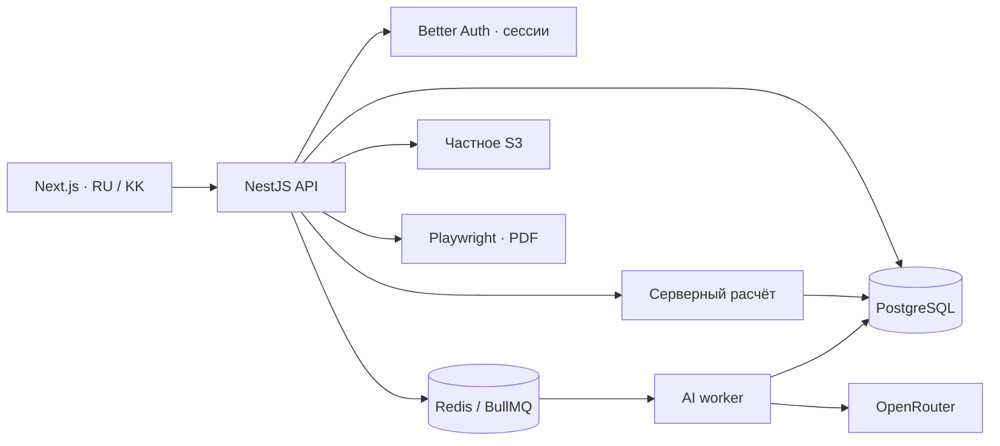

# Устройство AssessFlow

`apps/web` содержит только интерфейс. Ответы и выбранный язык передаются NestJS; ключи, нормирование и конфигурация расчёта не импортируются во frontend. Доступ к изображениям OMIB проходит через аутентифицированный API.

`AccessGuard` получает проверенную сессию, проверяет активное членство в выбранной организации и её статус. Заголовок `x-organization-id` является запросом выбора, а не доказательством доступа. Каждый запрос результатов дополнительно проверяет владельца или назначенного эксперта. Суперадминистратор имеет явное глобальное право. Составные внешние ключи закрепляют принадлежность кампаний, назначений, попыток, результатов, оценок и файлов на уровне PostgreSQL.

Пароли хеширует Better Auth. Cookie HttpOnly, SameSite=Lax, Secure при HTTPS, сессия 8 часов. После смены временного пароля сервер корректно передаёт новую cookie и отзывает другие сессии. Лимит входа есть для отдельного аккаунта и для источника. Публичная регистрация выключена. В production доверенный `X-Real-IP` перезаписывается Caddy; API доступен только во внутренней Docker-сети.

При создании попытки фиксируются язык, версия теста и ключ. Сохранение использует номер ревизии и блокировку строки попытки; устаревшая вкладка получает 409. Завершение использует ту же блокировку. Уникальность `(attemptId, scoringKeyId)` предотвращает повторную запись результата. Когнитивные результаты рассчитываются в том же запросе; AI работает отдельно. Перерасчёт добавляет запись и не меняет исходный результат.

Критерии и наблюдения версионируются. Итоговый отчёт сохраняет ссылки на определённые результаты, наблюдения и AI-анализ. Его новая редакция получает новый номер. Черновик недоступен участнику; утверждённый отчёт и предварительный анализ показываются только при разрешении организации.

AI получает обезличенный ID, категорию должности, версии методик, первичные шкалы и ограничения. ФИО/email не включаются. Свободные заметки эксперта автоматически не отправляются, поскольку могут содержать идентификаторы. Формат проверяется Zod, ссылки на основания — по разрешённым ID данного набора. Это структурная проверка; корректность содержательных выводов проверяет эксперт. Промпт и настройки маршрутизации фиксируются при постановке в очередь. Доступа OpenRouter к БД нет.

`tests/scoring.test.ts` проверяет арифметику, `tests/security.test.ts` — шифрование и контракт AI, `tests/integration.ts` — реальные HTTP/API/БД/S3/PDF-сценарии. Последний не является проверкой UI в браузере или результатом внешнего аудита безопасности.
